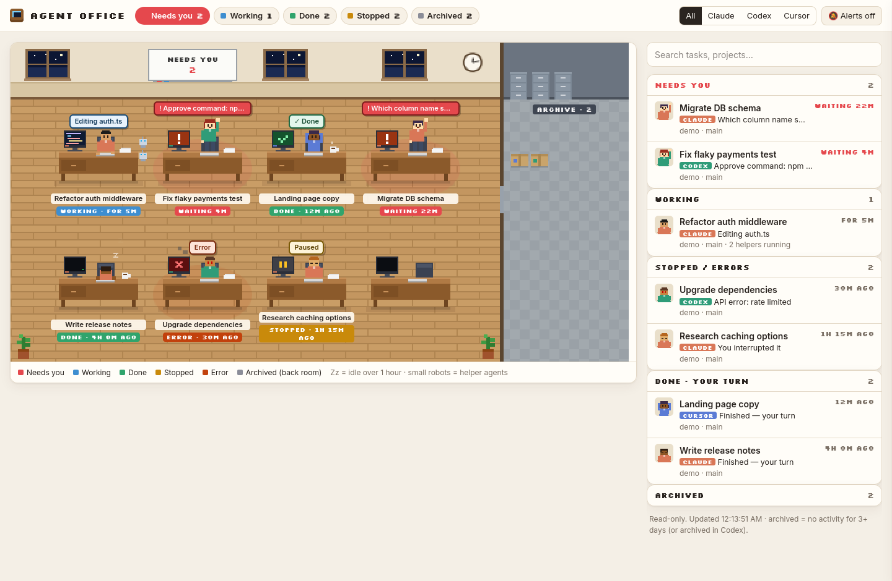
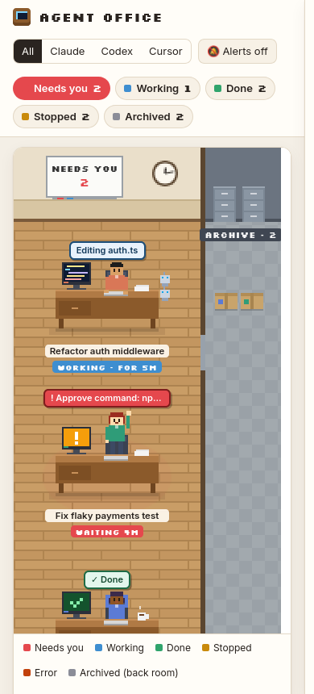

# Agent Office

A read-only pixel-art office that shows every AI coding agent on this machine and what it's doing:
who **needs you**, who is **working**, who is **done**, who **stopped or errored**, what's
**archived**, and how long each one has been inactive.

It never writes to agent files and never sends anything anywhere. It reads what Claude Code,
Codex and Cursor already save locally.





*Screenshots use demo data (`/#demo`).*

## What you see

- **Office floor:** one desk per agent.
  - Typing at a lit screen: **working**. The bubble shows the current action ("Editing auth.ts").
  - Standing, waving, red glow: **needs you**. The bubble says what it needs: a question, a permission, an approval.
  - Leaning back with a coffee: **done**. After an hour idle it falls asleep (Zz).
  - Pause icon: **stopped**. Smoking red screen: **error**.
  - Small robots next to a desk are helper agents (sub-agents) currently running.
- **Archive room:** a box for each archived session. Hover for its name, click for details.
- **Whiteboard:** how many agents need you. The browser tab title shows the same count.
- **Sidebar:** grouped Needs you → Working → Stopped/errors → Done → Archived, each with a
  timer ("waiting 22m", "4h ago", "idle 3d").
- **Details panel** (click any agent): last activity, inactive time, project, branch, model, cost,
  your last message, the recent conversation, and a copyable resume command.
- **Alerts** (top-right): a pop-up and beep when an agent starts needing you or finishes.
  Desktop notifications also work when opened via `localhost`.

## Run it

Requires **Node.js 22.5+**. There's nothing to install and no dependencies.

| OS | Command |
|----|---------|
| Linux / macOS | `./run.sh` |
| Windows | double-click `run.cmd` (or `npm start`) |

The first run prints a link like `http://localhost:3004/?key=…`. Open it once. The key is saved
as a cookie, so later visits to `http://localhost:3004` just work.

- **Over VS Code Remote-SSH:** run it in the VS Code terminal. VS Code forwards the port
  and the printed link opens in your laptop's browser.
- **Plain SSH:** `ssh -L 3004:localhost:3004 you@server`, then open the link on your laptop.
- **From your phone or other devices, via Tailscale:** bind to the machine's Tailscale IP. It's
  then reachable only from your tailnet, not your LAN or the internet:
  ```
  HOST=100.x.y.z PUBLIC_URL=http://100.x.y.z:3004 ./run.sh
  ```
  On Windows: `set HOST=100.x.y.z&& set PUBLIC_URL=http://100.x.y.z:3004&& run.cmd`
- **Preview without any chats:** open `/#demo`.

### Settings (environment variables)

| Var | Default | Meaning |
|-----|---------|---------|
| `PORT` | `3004` | Port to listen on |
| `HOST` | `127.0.0.1` | Interface to listen on: localhost, or a Tailscale IP |
| `PUBLIC_URL` | `http://localhost:PORT` | Only changes the link printed at startup |
| `ARCHIVE_DAYS` | `3` | Move a session to the archive room after this many idle days |

Windows: `set PORT=3010 && run.cmd`. Linux/macOS: `PORT=3010 ./run.sh`.

## Start on boot

### Linux (systemd user service)

1. Copy the unit file:
   ```
   mkdir -p ~/.config/systemd/user
   cp deploy/agent-office.service ~/.config/systemd/user/
   ```
2. Edit `~/.config/systemd/user/agent-office.service`:
   - If the repo isn't at `~/agent-office`, change the path in `WorkingDirectory` and `ExecStart`.
   - For Tailscale access, set `HOST` (and `PUBLIC_URL`) to your Tailscale IP.
3. Enable and start it:
   ```
   systemctl --user daemon-reload
   systemctl --user enable --now agent-office
   ```
4. Let it start at boot without logging in (one time):
   ```
   sudo loginctl enable-linger $USER
   ```
5. Get your link: `journalctl --user -u agent-office | grep Open:`

Day to day: `systemctl --user status|restart|stop agent-office`, logs with
`journalctl --user -u agent-office -f`. To remove it: `systemctl --user disable --now agent-office`.

### Windows (Task Scheduler)

Run this in a normal (non-admin) Command Prompt. Change the path to where you cloned the repo:

```
schtasks /Create /TN "Agent Office" /SC ONLOGON /RL LIMITED /TR "cmd /c cd /d C:\path\to\agent-office && run.cmd"
```

- For Tailscale access, put the settings before `run.cmd`:
  `... /TR "cmd /c cd /d C:\path\to\agent-office && set HOST=100.x.y.z&& set PUBLIC_URL=http://100.x.y.z:3004&& run.cmd"`
- It starts when you log in. That's when your agents run too, since they live in your user profile.
- Start it now without logging out: `schtasks /Run /TN "Agent Office"`.
- Remove it: `schtasks /Delete /TN "Agent Office" /F`.
- The console window must stay open. To hide it, open Task Scheduler → *Agent Office* →
  *Properties* and pick "Run whether user is logged on or not".
- Your link is printed in that window. The key is also saved in
  `%USERPROFILE%\.config\agent-office\key`, so the link is `http://localhost:3004/?key=<that key>`.

### macOS (launchd)

Not set up yet. For now, run `./run.sh` from a terminal, or add it under System Settings → General → Login Items.

## What it reads

| Agent | Location (under your home folder) | Notes |
|-------|-----------------------------------|-------|
| Claude Code (CLI + VS Code) | `.claude/projects/*/*.jsonl`, `.claude/sessions/*.json` | `sessions/` gives the live busy/idle state and PID |
| Codex | `.codex/state_*.sqlite`, `.codex/sessions/`, `.codex/archived_sessions/` | Uses Codex's own "archived" flag |
| Cursor | `.cursor/projects/*/agent-transcripts/` | Status is inferred from file activity |

It only sees agents that **run on this machine**. With VS Code Remote-SSH the agent runs on the
server, so run Agent Office there. Run a copy on each machine you use.

## How status is decided

| Status | Meaning |
|--------|---------|
| Needs you | Asked a question, is waiting for a permission/approval, or its last reply ends in a question |
| Working | Process is busy, or its file changed in the last 20 s |
| Done | Finished its turn. After 1 h idle the character falls asleep (Zz). |
| Stopped | Interrupted, or the window closed mid-task |
| Error | Last event was an API error |
| Archived | Archived in Codex, or no activity for `ARCHIVE_DAYS` |

Claude Code and Cursor keep their own "archive" toggle in the editor's client-side storage, which
isn't readable from here. That's why inactivity is used instead.

## Security

- Binds to `127.0.0.1` by default. With a Tailscale IP, only devices on your tailnet can connect,
  and Tailscale encrypts that traffic.
- Every request needs a random key, stored in `~/.config/agent-office/key` (mode 600), because
  other accounts on the same machine can reach localhost. Delete that file to rotate the key.
- GET-only. There are no endpoints that change anything.

## Files

```
server.js        scanner + API (Node built-ins only)
public/office.js pixel-art renderer (canvas)
public/app.js    UI: counts, list, details drawer, alerts
deploy/          systemd unit
docs/            screenshots
```
